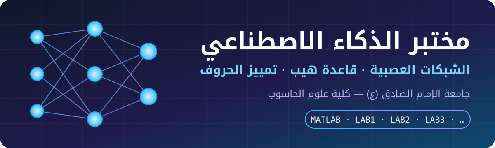
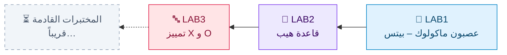
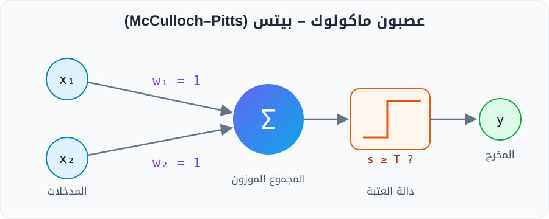
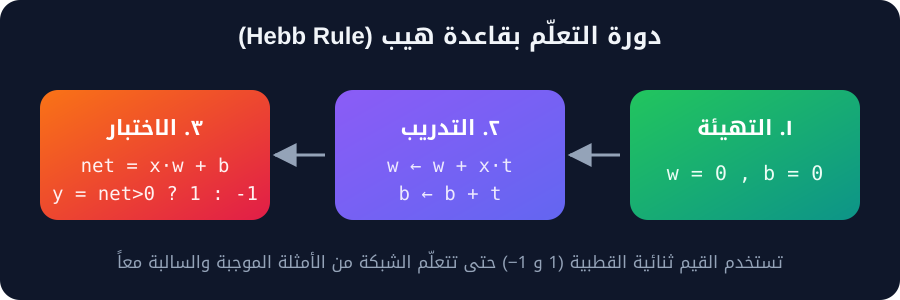
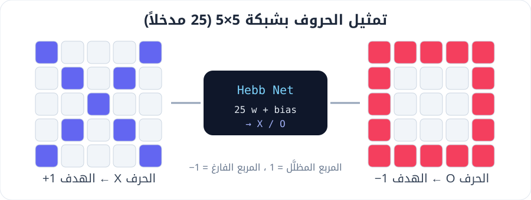
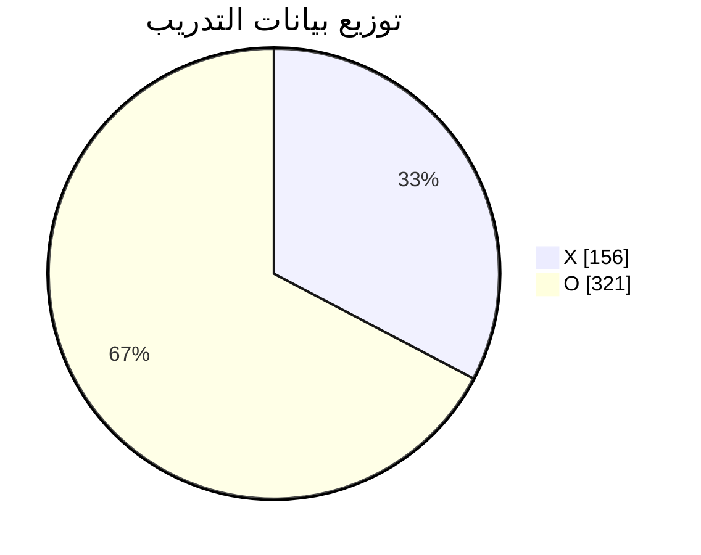
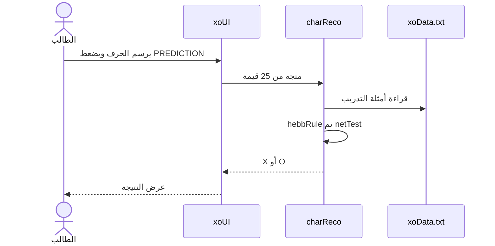

<div align="center">



<br/>


</div>

<div dir="rtl" align="right">

## 📖 نبذة عن المستودع

يضمّ هذا المستودع **مختبرات مادة الذكاء الاصطناعي** في **جامعة الإمام الصادق (عليه السلام)**، وهي مكتوبة بلغة **MATLAB**.
تبدأ المختبرات من أبسط نموذج للعصبون الاصطناعي، ثم تنتقل إلى **قاعدة هيب للتعلّم**، ثم إلى تطبيق عملي يميّز بين الحرفين **X** و **O** من خلال واجهة رسومية.

> 🚧 **المستودع قيد التحديث:** ستُضاف مختبرات جديدة تباعاً خلال الفصل الدراسي.

> 💡 **الهدف:** فهم كيف «تتعلّم» الشبكة العصبية من الأمثلة، خطوةً بخطوة، ومن الصفر.

---

## 🗺️ خريطة المختبرات

| المختبر | الموضوع | ما ستتعلّمه | المستوى |
| :---: | :--- | :--- | :---: |
| 🧪 **LAB1** | عصبون ماكولوك – بيتس | بناء البوابتين المنطقيتين AND و OR بدالة عتبة | ⭐ |
| 🧠 **LAB2** | قاعدة هيب (Hebb Rule) | تدريب شبكة بقيم ثنائية القطبية واختبارها | ⭐⭐ |
| 🔤 **LAB3** | تمييز الحروف X / O | شبكة بـ 25 مدخلاً مع واجهة رسومية للرسم والتنبؤ | ⭐⭐⭐ |
| ⏳ **LAB4+** | *قريباً…* | مختبرات جديدة تُضاف مع تقدّم المادة | — |



---

## 🧪 المختبر الأول: عصبون ماكولوك – بيتس

</div>

<p align="center"></p>

<div dir="rtl" align="right">

يحسب العصبون **المجموع الموزون** للمدخلات، ثم يقارنه بـ **العتبة T**:
إذا كان المجموع أكبر من العتبة أو يساويها يكون المخرج `1`، وإلا يكون `0`.
الأوزان ثابتة (`w = [1 1]`)، والذي يتغيّر بين البوابتين هو **العتبة فقط**:

<table>
<tr>
<th>بوابة AND &nbsp;(<code>T = 2</code>)</th>
<th>بوابة OR &nbsp;(<code>T = 1</code>)</th>
</tr>
<tr>
<td>

| x₁ | x₂ | المجموع | y |
|:-:|:-:|:-:|:-:|
| 0 | 0 | 0 | 0 |
| 1 | 0 | 1 | 0 |
| 0 | 1 | 1 | 0 |
| 1 | 1 | 2 | ✅ 1 |

</td>
<td>

| x₁ | x₂ | المجموع | y |
|:-:|:-:|:-:|:-:|
| 0 | 0 | 0 | 0 |
| 1 | 0 | 1 | ✅ 1 |
| 0 | 1 | 1 | ✅ 1 |
| 1 | 1 | 2 | ✅ 1 |

</td>
</tr>
</table>

📁 **الملفات:**

| الملف | الوصف |
| :--- | :--- |
| [`activation.m`](LAB1/activation.m) | دالة العتبة: تُرجع 1 إذا كان `s >= T` |
| [`AndFunc.m`](LAB1/AndFunc.m) | بوابة AND بعتبة `T = 2` |
| [`OrFunc.m`](LAB1/OrFunc.m) | بوابة OR بعتبة `T = 1` |

</div>

```matlab
function [ y ] = activation ( s,T )
    if s >= T
        y = 1
    else
        y = 0
    end
end
```

<div dir="rtl" align="right">

---

## 🧠 المختبر الثاني: قاعدة هيب (Hebb Rule)

</div>

<p align="center"></p>

<div dir="rtl" align="right">

تقوم فكرة هيب على مبدأ بسيط: **«العصبونات التي تنشط معاً تقوى الروابط بينها»**.
لكل مثال تدريب (مدخل `x` وهدف `t`) يُحدَّث الوزن والانحياز هكذا:

<p align="center">

$$w_{new} = w_{old} + x \cdot t \qquad\qquad b_{new} = b_{old} + t$$

</p>

ثم تُختبر الشبكة بدالة تفعيل ثنائية القطبية: المخرج `1` إذا كان `net > 0`، وإلا `-1`.

📁 **الملفات:**

| الملف | الوصف |
| :--- | :--- |
| [`hebb.m`](LAB2/hebb.m) | البرنامج الرئيسي: تهيئة، تدريب، ثم اختبار |
| [`hebbRule.m`](LAB2/hebbRule.m) | تطبيق قاعدة هيب على جميع الأمثلة (دورة واحدة) |
| [`hebbActivation.m`](LAB2/hebbActivation.m) | دالة التفعيل ثنائية القطبية (1 أو −1) |
| [`netTest.m`](LAB2/netTest.m) | حساب مخرج الشبكة لكل مثال |
| [`quiz.m`](LAB2/quiz.m) | سؤال تطبيقي للطالب |

<details>
<summary>❓ <b>سؤال الاختبار القصير — اضغط لعرض الحل</b></summary>

<br/>

**السؤال:** نُدرّب شبكة هيب على جدول AND **الثنائي** (0 و 1) بدءاً من `w1 = w2 = b = 0`. كم صفّاً من الصفوف الأربعة غيّر الأوزان أو الانحياز فعلاً؟

**الإجابة: (D) صفّ واحد فقط، وهو (1, 1).**

في الصفوف الثلاثة الأولى يكون الهدف `t = 0`، فيصبح التحديث `x · 0 = 0` و `b + 0`، ولا يتغيّر شيء.
لهذا نستخدم في قاعدة هيب القيم **ثنائية القطبية** (1 و −1)، حتى تتعلّم الشبكة من الأمثلة السالبة أيضاً.

</details>

---

## 🔤 المختبر الثالث: تمييز الحروف X و O

</div>

<p align="center"></p>

<div dir="rtl" align="right">

يُرسم الحرف على شبكة من **5 × 5** مربعات، فيصبح متجهاً من **25 قيمة** (المربع المظلَّل `1`، والفارغ `-1`).
تتدرّب شبكة هيب على البيانات المحفوظة في [`xoData.txt`](LAB3/xoData.txt)، ثم تتنبّأ: هل الشكل المرسوم **X** أم **O**؟

### 📊 بيانات التدريب

| البيان | القيمة |
| :--- | :---: |
| عدد الأمثلة | **477** |
| أمثلة الحرف X (الهدف `+1`) | 156 |
| أمثلة الحرف O (الهدف `−1`) | 321 |
| عدد المدخلات لكل مثال | 25 + عمود الهدف |



### 🖥️ الواجهة الرسومية `xoUI`

| الزر | وظيفته |
| :---: | :--- |
| ☑️ **المربعات 5×5** | ارسم الحرف بتحديد المربعات |
| 💾 **SET** | اكتب `x` أو `o` في الحقل ثم اضغط لحفظ المثال في ملف البيانات |
| 🔮 **PREDICTION** | تدريب الشبكة وعرض التنبؤ (X أو O) |
| 🧹 **CLEAR** | مسح الرسم والبدء من جديد |



📁 **الملفات:**

| الملف | الوصف |
| :--- | :--- |
| [`xoUI.m`](LAB3/xoUI.m) | الواجهة الرسومية للرسم والحفظ والتنبؤ |
| [`charReco.m`](LAB3/charReco.m) | تحميل البيانات، تدريب الشبكة، ثم التنبؤ |
| [`hebbRule.m`](LAB3/hebbRule.m) | قاعدة هيب لمدخلات متعددة الأبعاد |
| [`netTest.m`](LAB3/netTest.m) | حساب `net = x·w + b` |
| [`hebbActivation.m`](LAB3/hebbActivation.m) | تُرجع `'X'` إذا كان `net > 0`، وإلا `'O'` |
| [`importfile1.m`](LAB3/importfile1.m) | قراءة ملف البيانات النصي |
| [`xoData.txt`](LAB3/xoData.txt) | أمثلة التدريب (25 مدخلاً + الهدف) |

---

## 🚀 طريقة التشغيل

1. ثبّت **MATLAB** (أو **GNU Octave** للمختبرين الأول والثاني).
2. انسخ المستودع:

</div>

```bash
git clone https://github.com/jaafaralireeabi/AI-Course-imamSadiqUniversty.git
```

<div dir="rtl" align="right">

3. افتح MATLAB، وانتقل إلى مجلد المختبر المطلوب، ثم شغّل:

</div>

```matlab
% المختبر الأول
cd LAB1
AndFunc
OrFunc

% المختبر الثاني
cd ../LAB2
hebb

% المختبر الثالث (الواجهة الرسومية)
cd ../LAB3
xoUI
```

<div dir="rtl" align="right">

> ⚠️ **ملاحظة:** في المختبر الثالث يجب أن يكون مجلد MATLAB الحالي هو `LAB3`، لأن الدالة `charReco` تقرأ الملف `xoData.txt` من المجلد نفسه.

---

## 📂 هيكل المستودع

</div>

```text
AI-Course-imamSadiqUniversty/
├── 📁 LAB1/            ← عصبون ماكولوك – بيتس (AND / OR)
│   ├── activation.m
│   ├── AndFunc.m
│   └── OrFunc.m
├── 📁 LAB2/            ← قاعدة هيب
│   ├── hebb.m
│   ├── hebbRule.m
│   ├── hebbActivation.m
│   ├── netTest.m
│   └── quiz.m
├── 📁 LAB3/            ← تمييز الحروف X / O
│   ├── xoUI.m
│   ├── charReco.m
│   ├── hebbRule.m
│   ├── hebbActivation.m
│   ├── netTest.m
│   ├── importfile1.m
│   └── xoData.txt
├── 📁 LAB4 …         ← مختبرات قادمة 🚧
├── 📁 assets/          ← صور ورسومات الملف التعريفي
└── 📄 README.md
```

<div align="center">

---

<sub>صُنع بـ ❤️ لطلبة مادة الذكاء الاصطناعي — جامعة الإمام الصادق (ع)</sub>

</div>
